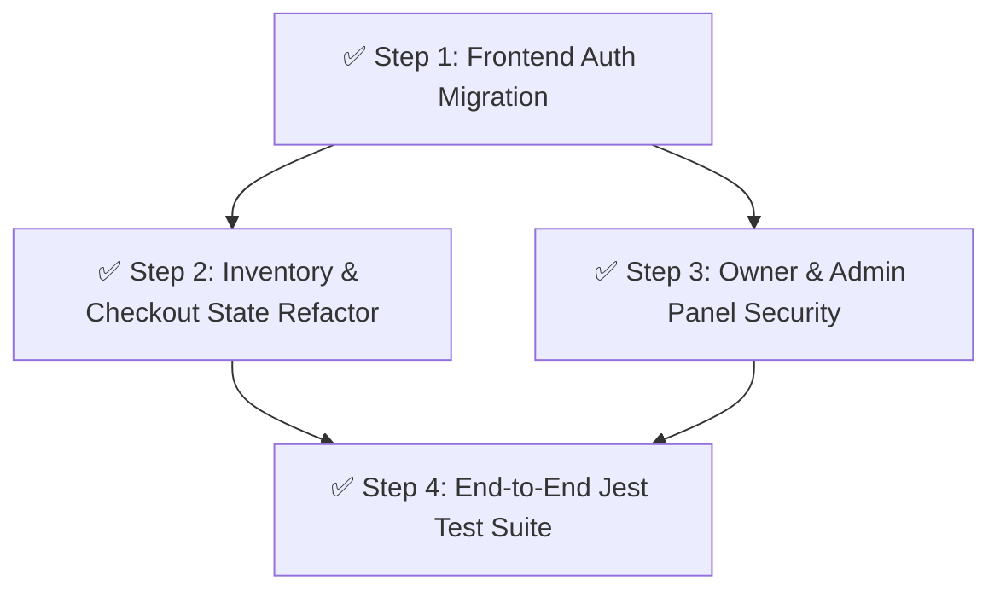

# FAANG Enterprise Frontend & System Completion Blueprint
**Objective:** Rewrite the entire frontend to consume HttpOnly cookies securely, implement React-like state management, and add end-to-end testing, fully satisfying the `AGENTS.md` enterprise standard.

## Pre-flight Context
Currently, the backend is secured with Prisma ORM, Zod Validation, and HttpOnly cookies. However, the frontend (`checkout.html`, `index.html`, etc.) still attempts to read/write to `localStorage` and lacks robust state management, making it fundamentally incompatible with the new backend and vulnerable to desyncs.

## Execution Graph

## Step 1: Frontend Auth Migration
- **Model Tier:** Strongest
- **Assigned Agent Persona:** `Security-Reviewer` & `Frontend-Engineer`
- **Context Brief:** The backend no longer issues JWTs in JSON payloads; it sets `HttpOnly` cookies. The frontend must be updated to stop looking for `localStorage.getItem('token')`.
- **Task List:**
  1. Remove all `localStorage.setItem('token', ...)` and `getItem('token')` from `auth.js` and `patch-auth.js`.
  2. Update all `fetch()` calls in the frontend to include `credentials: 'include'` so the browser automatically attaches the HttpOnly cookie.
  3. Create an `/api/auth/me` route in the backend that returns the current user's session data (since the frontend can no longer read the token payload directly).
- **Verification:** User can log in, and the `jwt` cookie appears in the DevTools Application tab.

## Step 2: Inventory & Checkout State Refactor
- **Model Tier:** Default
- **Assigned Agent Persona:** `Frontend-Engineer`
- **Context Brief:** Vanilla JS DOM manipulation leads to crashing and race conditions. We must implement robust state management patterns.
- **Task List:**
  1. Refactor `inventory.js` to use a centralized state object (`const AppState = { inventory: [], user: null }`).
  2. Implement an Observer pattern or use a lightweight reactive framework (like Alpine.js or HTMX) to bind the DOM to `AppState`.
  3. Sanitize all inputs in `checkout.js` before rendering to prevent XSS.
- **Verification:** Inventory renders from the centralized state; DOM updates cleanly without race conditions.

## Step 3: Owner & Admin Panel Security
- **Model Tier:** Default
- **Assigned Agent Persona:** `Security-Reviewer`
- **Context Brief:** Admin and Owner panels must have strict Role-Based Access Control (RBAC) enforced on the client side.
- **Task List:**
  1. Refactor `admin-panel.html` and `owner-panel.html` to fetch the user's role from `/api/auth/me`.
  2. If the role is insufficient, instantly redirect to `index.html` and clear state.
  3. Ensure all fetches from the admin panel include `credentials: 'include'`.
- **Verification:** A customer account cannot view or execute actions on the Admin Panel.

## Step 4: End-to-End Test Suite (Jest & Supertest)
- **Model Tier:** Strongest
- **Assigned Agent Persona:** `QA-Automation-Engineer`
- **Context Brief:** FAANG systems do not deploy without automated regression testing.
- **Task List:**
  1. Install `jest`, `supertest`, and `ts-jest`.
  2. Write `tests/auth.test.js` to verify registration, login, and HttpOnly cookie issuance.
  3. Write `tests/inventory.test.js` to verify Zod validation correctly blocks invalid inputs.
  4. Write `tests/booking.test.js` to verify booking creation and strict relational DB integrity.
- **Verification:** Running `npm run test` yields 100% pass rate.
