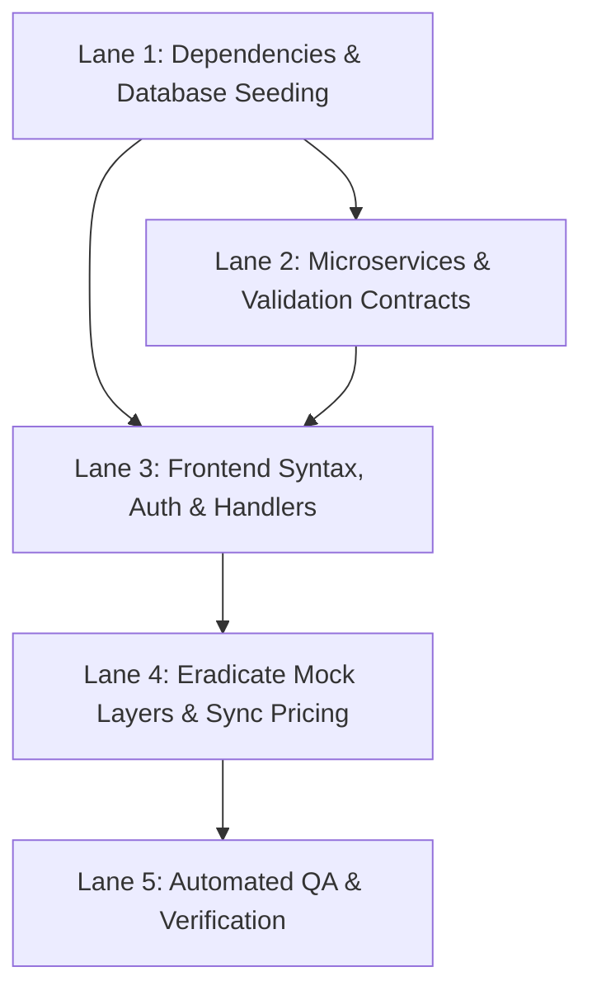

# 🏗️ Blueprint: Rownaa Full Engine Restoration & End-to-End Operationalization

**Objective:** Transform the Rownaa car rental platform from a broken/mock prototype into a 100% operational, fully connected enterprise system with real database persistence, real microservice communication, and zero dummy/mock functions.

---

## 🚦 Execution Graph & Lanes

---

## Lane 1: Dependencies & Database Seeding
**Goal:** Establish a working runtime environment and populate the database with real cars and accounts.

1. **Synthesize Dependencies (`package.json`)**:
   - Install all missing production dependencies: `express`, `sqlite3`, `bcryptjs`, `jsonwebtoken`, `cookie-parser`, `cors`, `helmet`, `http-proxy-middleware`, `socket.io`, `socket.io-client`, `uuid`, `zod`, `concurrently`.
   - Install devDependencies: `jest`, `supertest`, `cross-env`.
   - Verify `node_modules` exists and packages resolve.

2. **Authoritative Seed Script (`seed.js`)**:
   - Seed `users` with hashed bcrypt passwords:
     - Admin: `admin` / `admin123` (`role: 'admin'`)
     - Owner: `owner` / `owner123` (`id: 'biz-001'`, `name: 'Samiul Transport Agency'`, `role: 'owner'`)
     - Customer: `customer` / `customer123` (`id: 'cust-1'`, `name: 'Faisal Ahmed'`, `role: 'customer'`)
   - Seed `inventory` with Bangladesh fleet vehicles:
     - `Toyota Axio` (Sedan, 4 seats, 2 bags, AC, baseRate: 1500, tags: `['hourly', 'airport', 'intercity']`, ownerId: `biz-001`, isActive: 1)
     - `Toyota Allion/Premio` (Sedan Premium, 4 seats, 2 bags, AC, baseRate: 2000, tags: `['hourly', 'airport', 'intercity']`, ownerId: `biz-001`, isActive: 1)
     - `Toyota Noah/Voxy` (Microbus, 7 seats, 4 bags, AC, baseRate: 2500, tags: `['hourly', 'airport', 'intercity', 'tour']`, ownerId: `biz-001`, isActive: 1)
     - `Toyota HiAce` (Van, 11 seats, 6 bags, AC, baseRate: 3500, tags: `['hourly', 'airport', 'intercity', 'tour', 'corporate']`, ownerId: `biz-001`, isActive: 1)
     - `Toyota Prado / Camry` (Luxury/Executive, 5 seats, 3 bags, AC, baseRate: 4500, tags: `['hourly', 'airport', 'intercity', 'corporate']`, ownerId: `biz-001`, isActive: 1)
   - Ensure `db/pricing.json` is initialized with full pricing tier structure.

---

## Lane 2: Backend Microservices & API Contract Fixes
**Goal:** Make every backend service fault-tolerant and compliant with FAANG contracts.

1. **`services/auth/server.js`**:
   - Sign JWT with `{ id: user.id, userId: user.id, role: user.role, name: user.name }`.
   - Return `{ success: true, user: { id: user.id, userId: user.id, role: user.role, name: user.name }, role: user.role, name: user.name }`.
   - Ensure `res.cookie('jwt', token, cookieOptions)` has `sameSite: 'lax'` (or relaxed for localhost iframe/fetch).
2. **`services/booking/server.js`**:
   - Ensure vehicle lookup matches seeded vehicle names.
   - Verify double-booking prevention works and Socket.io broadcasts `booking_created` and `booking_updated`.
3. **`services/inventory/server.js`**:
   - Add default sorting and support for `includeDeleted`.
4. **`services/users/server.js`**:
   - Add `PUT /profile` to update user name and phone.
   - Add `PUT /:id/status` to approve/reject pending owners in SQLite.
5. **`shared/validations.js`**:
   - Add `'Ongoing'` to `updateBookingStatusSchema`.
   - Update `createCarSchema` to match SQLite columns (`name`, `category`, `baseRate`, `seats`, etc.).
6. **`dev-server.js`**:
   - Ensure gateway proxies `/api/auth` and `/api/me` without stripping path errors.

---

## Lane 3: Frontend Syntax, Auth & Action Handlers
**Goal:** Eliminate all JavaScript syntax errors and fix form submissions.

1. **Fix `invoice.html` Syntax**:
   - Change `document.addEventListener('DOMContentLoaded', () => {` to `document.addEventListener('DOMContentLoaded', async () => {`.
2. **Fix Auth Responses**:
   - In `login.html`, `login-cinematic.html`, `register.html`, `owner-register.html`:
     Replace `if (data.token)` with `if (data.success)`.
3. **Wire `login-sliding.html`**:
   - Add real submit listener sending POST `/api/login` and `/api/register`.
4. **Fix `js/bookings.js`**:
   - Ensure `updateStatus()`, `softDelete()`, and `restore()` return `res.ok`.
5. **Fix `owner-panel.html`**:
   - Set `ownerState.ownerId = user.id || user.userId`.
   - Wire "Add Vehicle" modal form to `window.InventoryManager.add()`.
   - Wire "Edit Profile" and "Payout Methods".
6. **Fix `customer-panel.html`**:
   - In `renderCustomerFleet()`: change `car.status !== 'Active'` to `!car.isActive && car.isActive !== undefined ? return : ...`.
   - Wire "Save Changes" in Profile to `PUT /api/users/profile`.
7. **Fix `admin-panel.html`**:
   - Include `js/users.js` and hook "Approve" / "Reject" partner buttons directly to `updateUserStatus()`.

---

## Lane 4: Eradicate Mock Layers & Sync Pricing
**Goal:** Ensure zero fake demo overlays and dynamic pricing consistency.

1. **Purge `js/demo-mode.js`**:
   - Remove `js/demo-mode.js` from filesystem and remove all references in HTML and build outputs.
2. **Synchronize `js/pricing.js`**:
   - Update `PricingEngine` to fetch configuration from `/api/pricing` on initialization and cache fallback to prevent ৳0 rates in `find-cars.html` and `checkout.html`.

---

## Lane 5: Automated Testing & Verification
**Goal:** Verify complete end-to-end functionality across all nodes.

1. **Implement `tests/e2e.test.js`**:
   - Point tests to the API gateway and verify auth, inventory, and booking routes with real assertions.
2. **Run End-to-End Verification**:
   - Launch dev-server and test complete user journey:
     - Register/Login customer
     - Browse fleet on `find-cars.html`
     - Book vehicle via `checkout.html`
     - Accept booking in `owner-panel.html`
     - View booking in `admin-panel.html`
     - Render print-ready receipt in `invoice.html`
