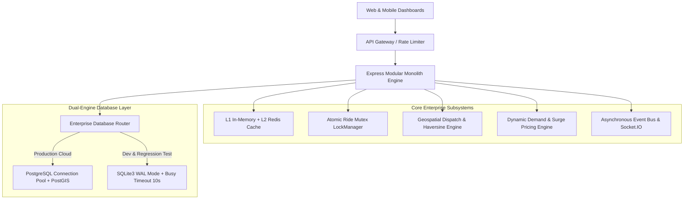

# Rownaa Enterprise Backend & Database Engine (Uber / Pathao Scale)

## Executive Objective
Transform the Rownaa backend and database architecture into a high-concurrency, geospatial-aware, enterprise ride-hailing and fleet dispatch engine equivalent to Pathao and Uber Black, while maintaining 100% backward compatibility with all existing REST endpoints and frontend dashboards.

---

## Architecture Blueprint

---

## Engineering Phases

### Phase 1: Dual-Engine Database Router (`src/config/db.js`)
- **PostgreSQL Connection Pool**: Automatic connection via `pg.Pool` if `DATABASE_URL` or `PG_HOST` is provided.
- **SQLite Concurrency Optimization**: Enable `PRAGMA journal_mode = WAL;`, `PRAGMA busy_timeout = 10000;`, `PRAGMA synchronous = NORMAL;`.
- **Universal Query Abstraction**: Query wrapper that automatically maps `?` placeholders to `$1, $2, ...` for PostgreSQL.
- **Transaction Engine**: Atomic multi-query transactions (`BEGIN`, `COMMIT`, `ROLLBACK`).
- **Telemetry Hook**: Real-time pool stats (`getPoolStats()`).

### Phase 2: Distributed Caching & Rate-Limiting Tier (`src/infrastructure/cache.js`)
- **Dual-Tier Cache**: Connects to Redis via `ioredis` when configured, with high-speed in-memory LRU fallback.
- **Cache-Aside Pattern**: `getOrSet(key, resolver, ttlSeconds)` for fleet inventory, pricing configs, and user sessions.
- **Invalidation Triggers**: Auto-purge keys on fleet mutation, pricing updates, or status changes.

### Phase 3: Geospatial Coordinate & Driver Dispatch Engine (`src/infrastructure/geospatial.js`)
- **Zone Registry**: Verified latitude/longitude coordinates for all major Dhaka zones and Bangladesh intercity routes.
- **Haversine Distance**: Accurate distance calculation in kilometers.
- **ETA & Congestion Estimator**: Real-time driving time estimation based on distance and zone traffic severity.
- **Nearby Fleet Dispatch**: Calculate distance from pickup location to all active vehicles; sort by proximity.

### Phase 4: Dynamic Surge & Traffic Multiplier Engine (`src/modules/pricing/surge.engine.js`)
- **Demand/Supply Ratio**: Evaluates active pending requests vs. available fleet vehicles in the requested zone.
- **Surge Multiplier**: Dynamically calculates fare multiplier (1.0x to 2.5x) based on real-time load.
- **Peak Hour Detection**: Configurable rush-hour and late-night surcharges.

### Phase 5: Atomic Ride Concurrency Lock (`src/infrastructure/lockManager.js`)
- **Atomic Mutex**: Prevents two concurrent users from reserving the same vehicle at the exact same time slot.
- **TTL Expiry**: Auto-release lock after 10 seconds to prevent deadlocks.

### Phase 6: Event-Driven Lifecycle & Socket Telemetry (`src/infrastructure/eventBus.js`)
- **Event Bus**: Emits `booking:created`, `booking:confirmed`, `booking:cancelled`, `driver:assigned`.
- **WebSocket Streaming**: Broadcasts live updates to customer and owner channels.
- **Telemetry API**: Exposes `/api/telemetry` with database engine, pool health, cache hit ratio, and active geospatial zones.

### Phase 7: Verification & Testing
- Write automated test suite validating multi-engine database routing, geospatial distance accuracy, surge pricing calculations, atomic lock protection, and cache hit ratios.
