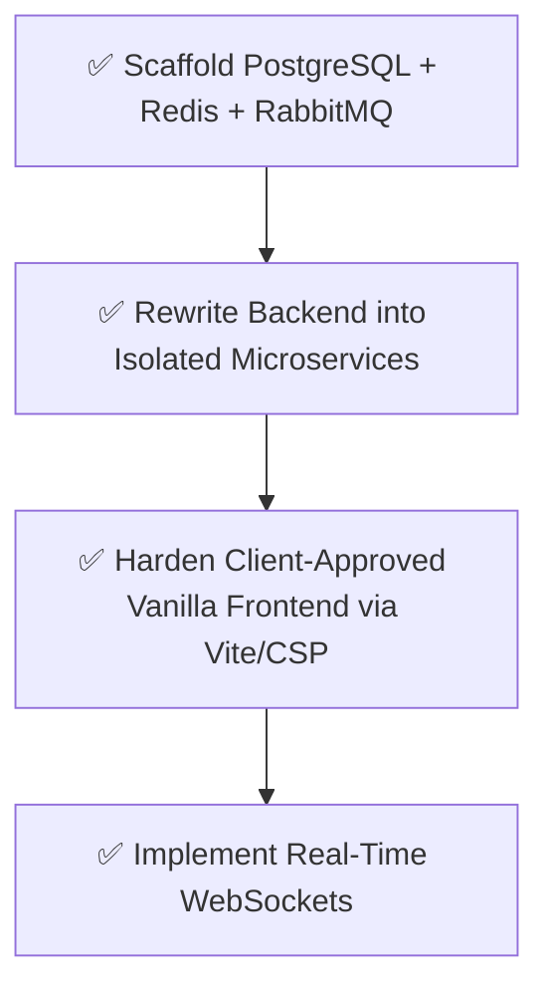

# Rownaa Uber-Scale Platform Rearchitecture

## Phase 1: Infrastructure & Microservices Foundation
1. **Initialize Monorepo Framework (Turborepo)**
   - Separate `apps/frontend` (Next.js) and `apps/backend` (Node API).
2. **PostgreSQL & Redis Implementation**
   - Replace SQLite with PostgreSQL for relational integrity and concurrent locks.
   - Implement Redis for high-speed caching and Rate Limiting (preventing scraping and DDoS).
3. **Message Queue (RabbitMQ)**
   - Setup RabbitMQ for asynchronous booking processing.

## Phase 2: Client-Approved Frontend Hardening
1. **Preserve Current UI/UX**
   - Retain the exact HTML/CSS design approved by the client.
2. **Enterprise Build Pipeline (Vite/Webpack)**
   - Introduce a bundler to minify, obfuscate, and chunk the Vanilla JS.
   - Inject strict Content Security Policies (CSP) to prevent XSS.
3. **Decoupled API Gateway**
   - The frontend will now communicate exclusively through an NGINX API Gateway, shielding the backend services.

## Phase 3: Real-Time WebSockets
1. **Socket.io Integration**
   - Push live booking status updates directly to the Customer and Owner apps without page reloads.

## Execution Graph

