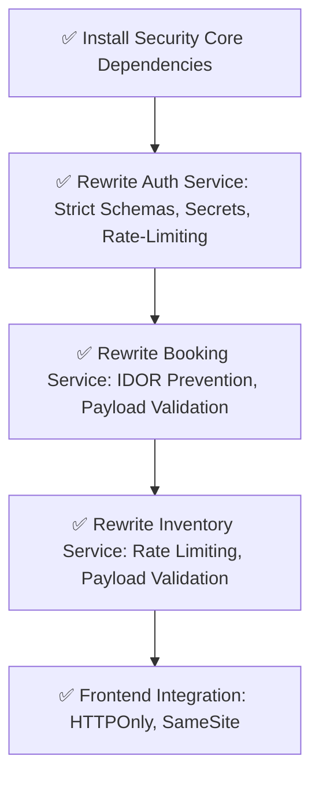

# 🛡️ FAANG-Level Zero-Trust Security Sweep (Blueprint)
**Status**: IN PROGRESS
**Orchestrator**: Lead Security Architect

## Execution Graph

## Phase 1: Security Core Dependencies
- Install `zod`, `express-rate-limit`, `csurf` in all microservices.

## Phase 2: Auth Service Lockdown
- Move `JWT_SECRET` strictly to `.env` throwing errors if missing.
- Add `express-rate-limit` for `/login` and `/register`.
- Create `auth.schema.js` and validate via Zod middleware.
- Generate and attach `CSRF Token`.

## Phase 3: Booking & Inventory Data Isolation (IDOR Prevention)
- Secure `GET /` to strictly filter by `req.user.userId`.
- Secure `PUT /:id/status`, `DELETE /:id` to verify ownership via `prisma.booking.findFirst({ where: { id, customerId: req.user.userId } })`.
- Add Zod middleware for all payload validations.

## Phase 4: Client-Side Security Headers
- Ensure the frontend fetches and attaches the CSRF token to all requests.
